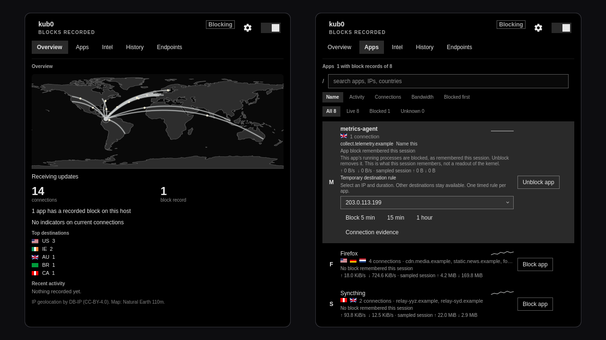

The first time I asked which app had opened a connection to port 8765, kub0 agent said `Curl`. A moment later I asked again. Same client port, same server port. This time the app was `unknown`.

Here are the fields I kept from the two snapshots. I took the first while curl was waiting for a local web server to reply. After curl exited, the second row turned up under `kub0 --json conns --unattributed`.

| When I looked | App | Client port | Destination | TCP state | Reason |
| --- | --- | ---: | --- | --- | --- |
| While curl was waiting | `Curl` | 45789 | `127.0.0.1:8765` | `ESTABLISHED` | |
| After curl exited | `unknown` | 45789 | `127.0.0.1:8765` | `FIN_WAIT2` | `orphan` |

The server had sent three bytes of response body and kept its side of the connection open. Curl had read all three, closed its socket, and exited. Linux was still waiting for the server to close its half. By then the kernel’s socket table showed inode zero. There was still a connection to describe, but no process holding a file descriptor that kub0 could follow back to an app. I knew it had been curl because I’d seen the earlier row. If I’d arrived a second later, I would have missed that evidence.

## What a five-second block looks like

**kub0 agent**, originally called **Vallum**, is a per-app network monitor and firewall for Linux. The next thing I wanted to know was what I’d see if curl stayed alive but its packets stopped getting through.

I ran the public v0.5.2 CLI and daemon with two web servers in a private Linux network namespace. Both servers listened on port 8765 and answered curl with HTTP 200. Then I set a five-second nftables rule for one address, following the project’s [timed-rule test](https://github.com/kub0-ai/kub0-agent/blob/v0.5.2/tests/test_scoped_nft.py){:target="_blank"}.

| Request from curl | Before the rule | While the rule was active | After expiry |
| --- | --- | --- | --- |
| `127.0.0.1:8765` | HTTP 200 | Timed out | HTTP 200 |
| `127.0.0.2:8765` | HTTP 200 | HTTP 200 | HTTP 200 |

While the first request was stuck, `kub0 conns --app curl` showed `SYN_SENT`. Linux had started the TCP handshake and was waiting for a reply. I could have seen the same state if the server had gone down. The second server kept answering throughout, and the first answered on the first try after the rule expired. That’s what tied the timeout to the rule.

## Trying it on a desktop

On Omarchy, the Apps tab puts the running app and its destinations side by side. If two apps use the same network and you want to quiet just one of them, pick that app. You can block its running process tree or select one observed IP and give the rule five minutes. Even if you close the panel, Linux still [expires the timed rule](https://github.com/kub0-ai/kub0-agent/blob/v0.5.2/docs/DESTINATION-RULES.md){:target="_blank"}.


_The release preview uses sample traffic. In the Apps view on the right, the selected address is the one a timed block would cover._

The map, panel, original connection monitor, and firewall helper came from Christopher Dwyer’s [omarchy-snitch](https://github.com/ccdwyer/omarchy-snitch){:target="_blank"}. If the interface looks familiar, that’s his work.

You can try the agent without a kub0 account. The panel is listed in the [Omarchy plugin marketplace](https://plugins.omarchy.org/plugin.html?id=ai.kub0.agent){:target="_blank"}. To add it from a terminal, run the following command.

```sh
omarchy plugin add https://github.com/kub0-ai/kub0-agent --enable
```

Open the panel, choose **Install kub0**, then log out and back in so your session can read the daemon. Try `kub0 apps --live` to see which apps have connections open right now. The same CLI works on a Linux server, with [installation instructions for a headless machine](https://github.com/kub0-ai/kub0-agent/blob/v0.5.2/README.md#servers-and-other-distributions){:target="_blank"}.

## Who else can read that row?

November 23 was the [first public release of kub0 agent](https://github.com/kub0-ai/kub0-agent/releases/tag/v0.5.1){:target="_blank"}. Two days later, v0.5.2 shipped four fixes reported privately during the Omarchy plugin marketplace review. One of them changed what “local” meant on a shared Linux machine.

The history database already had restricted permissions. Beside it, though, the daemon kept a log for connections like the one I started with, where it couldn’t attribute the socket to an app. A record could still contain a local account, a destination address, and a hostname. In v0.5.1, another account on the machine could read that file. The agent could come up short on my original question and still tell somebody else more than I intended. The details are in the [security advisory](https://github.com/kub0-ai/kub0-agent/security/advisories/GHSA-f4hv-9rmw-x2mh){:target="_blank"}.

In v0.5.2 the system daemon restricts that directory to root on startup. The first start after upgrading also fixes permissions on an existing installation. If you already use the plugin, update it and choose **Install kub0** again to get the [updated daemon](https://github.com/kub0-ai/kub0-agent/releases/tag/v0.5.2){:target="_blank"}.

“Which app opened that connection?” got me looking at the socket. The marketplace review left me with a second question. Once the connection is gone, who gets to look it up?

*Next: [The Safety Was On](/posts/the-safety-was-on/) follows the canary that tested whether kub0 could stop an executable.*
